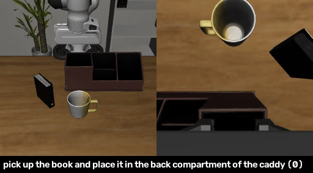
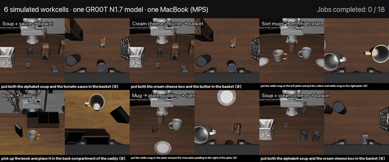

# GR00T N1.7 on Apple Silicon

This branch runs NVIDIA's `GR00T-N1.7-LIBERO` policy server and the LIBERO simulator on a Mac (PyTorch MPS), with no CUDA.



*`STUDY_SCENE1`: "pick up the book and place it in the back compartment of the caddy". Closed loop, MPS, seed 0.*

## Result

5 out of 5 closed-loop trials succeeded on one LIBERO-10 task.

| Seed | Result | Steps | Wall time | Video |
|---|---|---|---|---|
| 0 | success | 163 | 19.1 s | [seed_0.mp4](results/seed_0.mp4) |
| 1 | success | 172 | 19.8 s | [seed_1.mp4](results/seed_1.mp4) |
| 2 | success | 151 | 17.9 s | [seed_2.mp4](results/seed_2.mp4) |
| 3 | success | 165 | 19.2 s | [seed_3.mp4](results/seed_3.mp4) |
| 4 | success | 269 | 27.0 s | [seed_4.mp4](results/seed_4.mp4) |

Each policy call takes about 0.8–0.9 s (upper bound: wall time ÷ action chunks, 8 actions per chunk). Full record: [`results/report.json`](results/report.json).

Pinned to upstream commit `3b49067` and checkpoint `nvidia/GR00T-N1.7-LIBERO/libero_10` @ `6585403`.

## What differs from upstream

| Where | Change |
|---|---|
| `gr00t/policy/gr00t_policy.py` | Model weights and inputs in float32 instead of bfloat16 (committed on this branch) |
| server env | `scipy` upgraded past the pinned 1.15.3 |
| server env | `flash-attn` not installed, attention falls back to SDPA |
| sim env | `egl-probe` skipped (no EGL on macOS) |
| sim env | MuJoCo plugin folder disabled |
| sim env | `MUJOCO_GL=cgl`, `PYOPENGL_PLATFORM=darwin` |

Only the float32 change is committed. The environment changes were made by hand in the local venvs.

## Reproduce

Set up the sim and download the checkpoint as in [`examples/LIBERO/README.md`](../examples/LIBERO/README.md), applying the environment changes above. Then:

```bash
# Terminal 1: policy server on MPS (not `uv run`: it re-syncs scipy to 1.15.3, which fails on macOS)
.venv/bin/python gr00t/eval/run_gr00t_server.py \
    --model-path checkpoints/GR00T-N1.7-LIBERO/libero_10 \
    --embodiment-tag LIBERO_PANDA --device mps --use-sim-policy-wrapper

# Terminal 2: 5 seeded closed-loop trials, writes mac_port/runs/closed_loop_local/
python3 mac_port/run_libero_closed_loop.py
```

## Fleet demo



*6 simulated workcells · one GR00T N1.7 model · one MacBook (MPS).* Full-resolution video: [`results/fleet_demo.mp4`](results/fleet_demo.mp4) (1536×592, 31 s).

Six LIBERO-10 pick and sort tasks, three seeded jobs each, all driven by the same `libero_10` checkpoint. The jobs ran one after another against a single MPS policy server, and the grid was assembled afterwards from the recorded clips. The workcells did not run simultaneously in real time. The counter goes up on the frame where each successful job ends, and failed jobs are not counted.

17 of 18 jobs succeeded.

| Workcell | Succeeded | Steps (seeds 0, 1, 2) |
|---|---|---|
| Soup + sauce → basket | 3/3 | 338, 282, 231 |
| Cream cheese + butter → basket | 3/3 | 231, 242, 232 |
| Sort mugs → left / right plate | 2/3 | 720 (hit the step limit), 234, 215 |
| Book → caddy | 3/3 | 160, 157, 150 |
| Mug → plate, pudding → right | 3/3 | 282, 280, 201 |
| Soup + cream cheese → basket | 3/3 | 412, 268, 233 |

Full record: [`results/fleet_report.json`](results/fleet_report.json).

```bash
# Terminal 1: start the server with the venv's python directly. `uv run` re-syncs the env
# back to the pinned scipy 1.15.3, which fails to load on macOS.
.venv/bin/python gr00t/eval/run_gr00t_server.py \
    --model-path checkpoints/GR00T-N1.7-LIBERO/libero_10 \
    --embodiment-tag LIBERO_PANDA --device mps --use-sim-policy-wrapper

# Terminal 2: 18 jobs (~10 min), then render. Add --render-only to rebuild the video from runs/fleet/report.json.
cd mac_port && ../gr00t/eval/sim/LIBERO/libero_uv/.venv/bin/python run_fleet_demo.py
```

## Trained vs untrained tasks

This run uses the same checkpoint, robot, simulator, seeds (0–2) and 720-step limit as the fleet demo. The six tasks come from the LIBERO object, spatial and goal sets, which this `libero_10` checkpoint was **not** fine-tuned on. They are simple single-object pick-and-place tasks, and several use objects the trained tasks also use. Video: [`results/untrained_check.mp4`](results/untrained_check.mp4) (56 s). Full record: [`results/untrained_report.json`](results/untrained_report.json).

| | Trained tasks (fleet demo) | Untrained tasks |
|---|---|---|
| Jobs succeeded | **17 / 18** | **4 / 18** |

| Untrained task | LIBERO set | Succeeded | Steps (seeds 0, 1, 2) |
|---|---|---|---|
| Soup → basket | object | 2/3 | 367, 385, 720 |
| Tomato sauce → basket | object | 0/3 | 720, 720, 720 |
| Bowl (centre) → plate | spatial | 2/3 | 720, 550, 336 |
| Bowl (by ramekin) → plate | spatial | 0/3 | 720, 720, 720 |
| Bowl → plate | goal | 0/3 | 720, 720, 720 |
| Cream cheese → bowl | goal | 0/3 | 720, 720, 720 |

Every failure hit the 720-step limit. Caveats:
- Each task was run only 3 times, so the per-task numbers are rough. The overall gap is large.
- The untrained sets also use different scenes and layouts. So this measures "new scene plus new instruction", not new objects alone.
- Some skill does carry over: the familiar soup-and-basket setup and the simplest bowl task each succeeded twice.

```bash
cd mac_port && ../gr00t/eval/sim/LIBERO/libero_uv/.venv/bin/python run_untrained_check.py   # ~18 min
```
